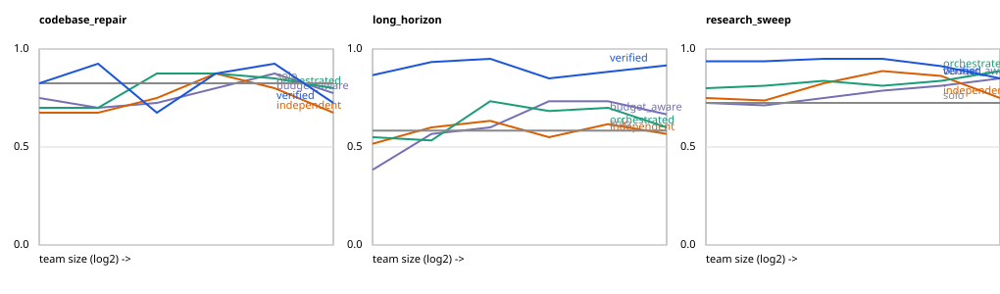

# optimized agent team scaling

A small, self-contained lab for studying how **teams of agents** scale: what
happens to success, cost, and coordination as the number of agents, the
compute budget, and the length of the task grow — and how much of the measured
result is the work, and how much is an artifact of the evaluation.

**Honest scope, up front:** the agents in v1 are *simulated*. An attempt's
outcome comes from an explicit probability model (subtask difficulty, the
agent's accumulated context load, dependency health, horizon depth) driven by
a seeded RNG, so the full grid runs offline in about 25 seconds with no API
keys and every number is reproducible.

 The science here is in the harness,
the coordination strategies, the sandboxed verification, and the evaluation
audits — not in any claim about real LLM behaviour. An `AgentBackend`
protocol (`teamscale/agents.py`) is the seam where a real LLM backend plugs
in later; `LLMBackend` is a documented stub that raises `NotImplementedError`.

## the questions this lab asks

Teams of agents are getting bigger, but bigger is not obviously better: every
added agent costs tokens, coordination, and new ways to fail. This lab exists
to answer, with experiments rather than intuition:

1. **Scaling** — as a team grows from 1 to 32 agents, how do success, cost,
   and wall time actually change? The answer turns out to depend on the
   coordination strategy and on whether the task decomposes at all.
2. **The bend** — where does the curve bend: at what team size does one more
   agent stop paying for itself?
3. **Coordination** — how much work do uncoordinated teams duplicate, and
   does paying for verification earn its cost back?
4. **Budgets** — given a fixed compute budget, how should it be allocated
   across a team and its subtasks to finish fastest and most reliably?
5. **Trust** — how much of any measured result is the work, and how much is
   an artifact of how it was evaluated?

## what's inside

| piece | what it does |
|---|---|
| `teamscale/experiment.py` | the experiment grid (450 runs): scaling tables, bend points, best strategy under a fixed budget |
| grid axes | team size {1…32} × compute budget × `horizon_scale`, across three task families with different parallelism structure |
| `teamscale/harness.py` | discrete-event scheduler over a dependency DAG, hard token budgets, per-run JSONL traces, budget-skip and error-propagation semantics — the machinery for running large teams reliably and debugging the failures that only appear at scale |
| `long_horizon` + `teamscale/audits.py` | evaluation for long-horizon problems, and the audits that keep its results trustworthy |
| `teamscale/metrics.py`, `python -m teamscale.trace_summary` | metrics and traces, so a run can be read and understood in minutes |
| `budget_aware` strategy | difficulty-proportional allocation of a fixed budget, with reserves |
| the audits | distinguish real gains from artifacts of the evaluation setup — this project's signature piece |

## design choices

Three design choices define the project:

1. **Evaluation-artifact audits** (`teamscale/audits.py`), inspired by
   *Unsolvability Ceiling in Multi-LLM Routing: An Empirical Study of
   Evaluation Artifacts* — every headline number gets audited before it is
   trusted:
   - `lenient_vs_strict`: re-scores a run with a lenient (partial-credit)
     verifier vs the strict ground truth and reports the inflation delta.
   - `no_work_baseline`: a control "team" that returns topic-only guesses
     without doing any work, scored the same way — it establishes the floor
     the evaluation gives away for free.
   - `seed_sensitivity`: the same config across 5 seeds, so a single-seed
     gain is never quoted without its variance.
2. **Budget-aware allocation** (`budget_aware` strategy): the total token
   budget is split across subtasks in proportion to difficulty *before* the
   run, with worst-case reserves; retries are skipped once the budget runs
   low. Money goes to first attempts on hard subtasks, not re-rolls of easy
   ones.
3. **Real sandboxed verification for code tasks**: `codebase_repair` agents
   write actual Python modules into a per-run sandbox directory (path
   containment is enforced and tested), and ground truth is established by
   *executing* each module's check script in a subprocess with a timeout —
   not by comparing strings.

A methodology note we hold ourselves to: all-or-nothing success ("every
subtask correct") over a handful of seeds only takes values k/n and its
apparent bend points are seed noise. Bend points here are therefore read off
the **mean fraction-correct curve**; success rates are still reported in
`results.csv` / `summary.json` alongside.

## architecture

```
teamscale/
  agents.py       SimulatedAgent (seeded, configurable cost/latency/error model)
                  + AgentBackend protocol + LLMBackend stub
  tasks.py        task DAGs and verifiers for the 3 families; sandbox helpers
  strategies.py   solo / independent / orchestrated / verified / budget_aware
                  + the difficulty-proportional budget allocator
  harness.py      discrete-event run simulation; hard budget cap; JSONL traces
  metrics.py      per-run metrics (success, fraction, tokens, wall time,
                  coordination overhead, duplication rate, retries, per-agent load)
  audits.py       lenient_vs_strict, no_work_baseline, seed_sensitivity
  experiment.py   the grid CLI; scaling tables, bend points, best-under-budget
  trace_summary.py  trace.jsonl -> a timeline a researcher can read in minutes
experiments/
  make_plots.py   scaling_curves.png / .svg from results.csv
  results.csv / results.json / summary.json   (generated, git-ignored)
  traces/, sandboxes/                          (generated, git-ignored)
tests/            pytest suite (20 tests)
```

Task families: `research_sweep` (16 independent lookups — parallelizable),
`codebase_repair` (8 file repairs, really executed), `long_horizon` (a
12-link dependency chain — errors propagate, parallelism barely helps).

## run it

```bash
python3 -m venv .venv && .venv/bin/pip install pytest matplotlib   # dev tools only; the package itself is stdlib-only

.venv/bin/python -m pytest                                   # 20 tests
.venv/bin/python -m teamscale.experiment                     # full grid (450 runs, ~25 s) + artifact audit
.venv/bin/python experiments/make_plots.py                   # experiments/scaling_curves.png
.venv/bin/python -m teamscale.trace_summary experiments/traces/long_horizon-verified-n8-b9666-h1.0-s0.jsonl
```

Useful knobs: `--seeds N`, `--out DIR`, `--no-audit`,
`--audit-family/--audit-strategy/--audit-team` to choose the audited config.

## headline results (this run; simulated agents)

Grid: team sizes {1, 2, 4, 8, 16, 32} × 5 strategies × 3 families × 5 seeds
= **450 runs**, fixed budgets (research_sweep 8,488 / codebase_repair 6,150 /
long_horizon 9,666 tokens). Full data in `experiments/summary.json`.

**Best strategy under the fixed budget — `verified`, in all three families**
(verification + one retry costs the most tokens and still wins):

| family | mean success rate | mean fraction correct | mean tokens |
|---|---|---|---|
| research_sweep | 0.333 | 0.923 | 8,138 |
| codebase_repair | 0.300 | 0.821 | 5,835 |
| long_horizon | 0.367 | 0.900 | 9,190 |

**Bend points** (team size where the marginal gain in mean fraction correct
per added agent drops below 2 points; per-strategy bends in `summary.json`):

| family | bend (overall) | reading |
|---|---|---|
| research_sweep | 2 | gains are small but steady to n=32 for most strategies; wall time is where teams pay off (52.5 s solo → 8.3 s at n=8 → 4.9 s at n=32, orchestrated) |
| codebase_repair | 2 | quality is flat in team size — the work is verification-bound, not parallelism-bound; `verified` bends at 4 |
| long_horizon | 8 | the chain caps everything: orchestrated wall time is ~52–53 s at *every* team size; only verification moves quality (0.55 → 0.95 fraction correct at n=4) |

**Coordination is measurable**: the `independent` strategy duplicates 16.1%
of subtasks on average (orchestrated: 0% by construction) and spends the
savings nowhere — its token count *rises* with team size (5,992 at n=1 →
7,721 at n=32 on research_sweep) while quality stalls.

**Artifact audit** (long_horizon / orchestrated / team of 4):

```
strict score (this run)      : 0.750
lenient re-score             : 0.875  (inflation +0.125)
no-work baseline             : strict 0.000 / lenient 0.500  <- what the eval gives away for free
seed sensitivity (5 seeds)   : mean 0.733 +/- 0.111, range 0.333
```

Read that as: a lenient scorer would report this run as 0.875 instead of
0.750; a team doing literally no work still banks 0.500 under that scorer;
and the same config swings 0.583–0.917 across seeds, so no single-seed
comparison in the tables above should be quoted without its neighbours.

## limitations

- Agents are simulated; the probability model is a stated assumption, not a
  measurement. Curves show what the *harness and strategies* do under that
  model — the shapes (chain-bound horizons, duplication waste, verification
  value) are the findings, not the absolute numbers.
- Wall time is simulated (step latency), not measured.
- The strict success metric (all subtasks correct) is intentionally harsh
  and noisy at 5 seeds; fraction correct is the reliable signal.
- One retry, perfect verifier: the `verified` strategy's verifier is the
  ground truth itself. A learned or LLM-judge verifier would be noisier —
  that gap is exactly what the lenient audit is for.
- Grid budget is fixed per family at 1.5× the expected solo cost; budgets
  bind hardest on `verified` at large team sizes (coordination overhead
  grows with n), which is visible as quality *dipping* at n=32 in places.

## next steps

- Plug a real LLM backend into `AgentBackend` and re-run a slice of the grid
  (start with research_sweep at n ∈ {1, 4, 16}) to compare curve shapes
  against the simulated model.
- Long-horizon suites in the style of GAIA / WebArena: longer chains with
  tool use, scored by the same audits.
- Multi-process execution so wall time is measured, not simulated, and the
  sandbox runs workers in parallel for real.
- A noisy-verifier variant of `verified` (verifier accuracy as a knob) to
  find where verification stops paying.
- More seeds + confidence intervals on the scaling tables by default.

## license

MIT
