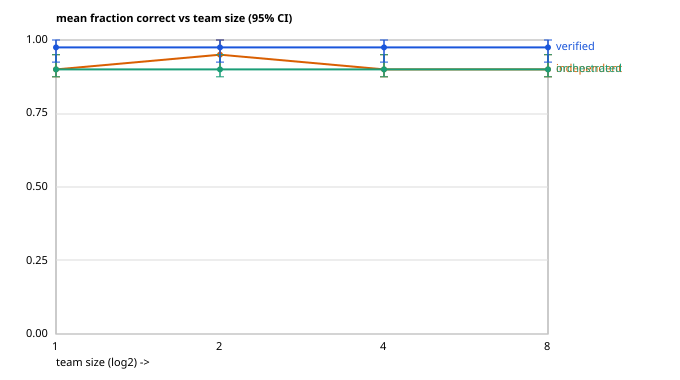

# AgentLab

**A reproducible laboratory for studying the scaling behavior of LLM
agent organizations.**

AgentLab is a reproducible laboratory for empirical research on
multi-agent LLM systems. Rather than providing new agent
architectures, it provides the infrastructure to ask and answer
controlled research questions: reproducible experiments, calibration
gates, deterministic replay, and auditable analyses. Version 1.0
demonstrates this methodology through three empirical studies on
Claude Haiku 5.5.



```
Experiment config
        │
        ▼
 Task generator
        │
        ▼
 Agent execution
        │
        ▼
 Verification
        │
        ▼
 Replay
        │
        ▼
 Analysis
```

Every experiment is one config file that states the whole design up
front; every result is a sealed, replayable bundle another
researcher can regenerate and audit.

## Why AgentLab?

Existing agent benchmarks often assume task difficulty rather than
measuring it, making scaling conclusions sensitive to hidden
evaluation artifacts. AgentLab treats benchmark design, calibration,
replay, and analysis as first-class research objects.

## Engineering invariants

Experiments are only as trustworthy as the infrastructure that
produces them, so the platform is held to four invariants
([`ENGINEERING.md`](ENGINEERING.md)):

1. **Generator determinism** — a generated task is a pure function
   of (seed, generator_version). Nothing else: no hidden randomness,
   no timestamps, no mutable templates.
2. **Immutable artifacts** — every run directory is write-once and
   sealed with `hashes.json`; if anything changes, the seal breaks
   and replay refuses to trust it.
3. **First-class provenance** — every bundle's manifest answers
   "exactly what generated me?" on its own: model, prompt hash,
   generator / calibration / replay / analysis versions, git commit
   and dirty flag, pricing.
4. **Analysis purity** — the analysis consumes only recorded
   metrics; contrasts and axes are declared in the experiment
   config, never hardcoded, so the same machinery serves every
   experiment.

Releases follow a gate discipline: engineering checklist →
calibration gate → tagged release → clean tree → one frozen run →
replay → analysis. Code does not change during a run; an issue found
mid-run is documented and fixed afterward, under a new version.

## The three methodological contributions

### 1. Artifact-resistant evaluation

An experiment can measure its own setup instead of the phenomenon it
claims to study, and the failure mode is silent: the numbers look
clean. AgentLab's first phase began with exactly that failure. In
the initial real pilot, every configuration scored a perfect
fraction correct — independent, orchestrated, and verified, at
every team size. The experiment had saturated and could not answer
its own question: each agent carried a check tool inside its
attempt, self-verified until the check passed, and strategy-level
verification never had a failure to catch. A setup that masks the
effect it claims to measure is an evaluation artifact.

Phase A removed the mask. Under **blind execution** — agents can
read and write but cannot execute checks, so the external check is
the only feedback in the system — external verification produced a
real improvement over matched orchestration, and the effect was
**flat across team size**: verification acts as per-subtask
insurance, not as a scaling effect. Coordination alone bought no
quality, only cost. The platform's artifact audits (lenient-vs-strict
rescoring, a no-work baseline, seed sensitivity) exist so that this
class of error is looked for, not stumbled into.

### 2. Calibration gates and mechanistic benchmarking

A scaling variable should change the mechanism, not just the amount
of work. Phase A-2 tested a mechanism — **error accumulation**:
under sequential dependency, an unrecovered error propagates, so
verification's benefit should grow with chain length. The hypothesis
was pre-registered with its falsification criterion before any data
existed, and the experiment was gated: an offline **calibration
gate** first had to show that step difficulty was statistically
indistinguishable across chain positions, so a horizon effect could
not be dismissed as "longer is simply harder." The gate did its job
on the first attempt — it **rejected the first chain generator
before any live run**, because its operations made defects less
visible at later positions. Only after the generator was fixed and
the gate passed did the experiment run.

The run produced **no first-submission failures at any horizon**, in
either strategy. Stated precisely: the intervention failed to
induce the error regime required to identify the proposed
mechanism. That is a different statement from "verification doesn't
help" and from "the tasks were too easy" — difficulty was
calibrated uniform across positions; what never occurred was the
phenomenon under study.

**The platform rejected its own hypothesis for the correct reason.**

### 3. Model-calibrated benchmark generation

Phase A-2's lesson generalizes: a benchmark's difficulty is
typically an intuition asserted by its author, yet it silently
decides whether the phenomenon under study exists at all. Phase A-3
makes difficulty a **measured, controlled variable**. A closed-loop
controller — setpoint: a requested first-attempt failure band;
error signal: the probed rate's confidence interval; adjustment: a
difficulty ladder of composite steps, state size, and interacting
parts — calibrates a task family to the target model before the
family is used to study anything.

One requested band converged and **validated on held-out seeds**:
when a generator supports a requested operating point, the
controller finds it and the calibration transfers to data the search
never touched. For another requested band, the verdict was about
the generator, not the algorithm:

**The calibration procedure correctly diagnosed that the current
generator family cannot represent that operating point.**

The ladder jumps across that band in a single rung, and no setting
exists in between. The controller declared failure against its
pre-registered criterion rather than widening the tolerance or
interpolating an answer. The limitation is in the generator's
resolution, not in the calibration algorithm — and the
methodology's purpose is precisely to keep those two components
distinguishable.

## Results

Summary artifacts for all three phases — summaries, analyses,
manifests, calibration reports, figures — are published in
[`results-published/`](results-published/). The caveats in each
summary stand: one model, one task family per phase, a perfect
(ground-truth) verifier, sequential execution within runs, and
intervals that are wide by construction at five seeds per cell.

- **Phase A — verification under blind execution.**
  Verified 0.975 vs orchestrated 0.900 fraction correct; primary
  contrast +0.075 [+0.044, +0.106], flat across team sizes 1–8;
  coordination alone added cost, not quality. 60 runs, $0.34 total,
  replay exact.
  [Summary](results-published/phase-a/SUMMARY.md) ·
  [figures](results-published/phase-a/figures/)
- **Phase A-2 — error accumulation.**
  Calibration gate rejected the first generator, then passed over
  25,000 generated steps; the experiment found zero first-submission
  failures in 870 steps across horizons 2–50, so the accumulation
  mechanism was unidentifiable in that regime — not falsified, and
  not an artifact: agents were blind, grading used first
  submissions, and the bundle replays exactly. 50 runs, $0.47 total.
  [Summary](results-published/phase-a2/SUMMARY.md) ·
  [calibration](results-published/phase-a2/calibration.json) ·
  [figures](results-published/phase-a2/figures/)
- **Phase A-3 — model-calibrated generation.**
  The 5% ± 2% band converged in 2 iterations ($0.46 of probing) and
  validated on held-out seeds at 0.050 [0.034, 0.073]. For the 10%
  band, the calibration procedure correctly diagnosed that the
  current generator family cannot represent that operating point —
  the ladder jumps from 3% to 34% across one rung boundary, and the
  tolerance was left untouched. 1,500 probes, $2.08 total, replay
  exact.
  [Summary](results-published/phase-a3/SUMMARY.md) ·
  [calibration](results-published/phase-a3/calibration.json)

The full decision history — questions, alternatives considered and
rejected, threats named in advance, outcomes, and a "What would have
changed my mind?" section per experiment — is in
[`RESEARCH_LOG.md`](RESEARCH_LOG.md). The pre-registered designs are
in `experiments/*/DESIGN.md`.

## Running an experiment

```bash
python3 -m venv .venv && .venv/bin/pip install pytest   # dev tool only; the package is stdlib-only
.venv/bin/python -m pytest                              # 132 tests

export TEAMSCALE_PROVIDER=anthropic
export TEAMSCALE_ANTHROPIC_CRED_CMD="<command whose stdout is your API key>"   # or export ANTHROPIC_API_KEY=...
export TEAMSCALE_MODEL=claude-haiku-5-5

.venv/bin/python -m teamscale.experiment experiments/verification-question/experiment.yaml   # Phase A
.venv/bin/python -m teamscale.experiment experiments/error-accumulation/experiment.yaml      # Phase A-2 (requires a passing calibration gate)
# Phase A-3: see experiments/model-calibrated-generation/DESIGN.md

.venv/bin/python -m teamscale.replay  results/<experiment>/<run-id>   # verify a run deterministically
.venv/bin/python -m teamscale.analyze results/<experiment>/<run-id>   # regenerate figures from metrics.csv alone
```

Add `--fake` to run an identical pipeline offline on the
deterministic fake backend ($0, no network) — that is how the
pipeline itself is tested end to end. The API key is only ever
obtained from the credential command or the process environment —
never read from a file, logged, or written into results. Full
per-experiment detail lives in each `experiments/*/DESIGN.md`.

A run creates a fresh, immutable directory
`results/<experiment>/<run-id>/` (writing into an existing run
directory is refused) containing the manifest (config, git commit,
versions, prompt hash), `metrics.csv`, traces, the graded sandboxes,
the spend ledger, the summary, the calibration evidence where
applicable, figures, and the `hashes.json` seal over all of it.

**Replay** is deterministic and scoped honestly: it does *not*
re-run the model (live sampling is not replayable). It regenerates
each task from its seed, re-executes every check against the saved
sandboxes, and recomputes token accounting and costs — asserting
all of it matches the recorded metrics exactly. **Analyze** reads
the recorded metrics alone; its bootstrap is seeded from the
metrics file itself, so outputs are byte-identical on re-runs.

**Honest scope.** AgentLab also contains *simulated* agents — an
explicit probability model driven by a seeded RNG. The simulated
grid is how the harness and strategies were developed and audited;
its numbers say what the harness does under that stated model, not
what real LLMs do. Every v1.0 result above comes from the real
backends. The artifact audit on the simulated grid is where the
lenient-vs-strict inflation (+0.125) and no-work-baseline (0.50
under a lenient scorer, 0.00 strict) measurements come from.

## What's inside

| piece | what it does |
|---|---|
| `teamscale/config_experiment.py` | config-driven experiments: one YAML file → one immutable, manifest-first run directory |
| `teamscale/llm_backend.py` / `anthropic_backend.py` | real LLM backends (OpenAI / Anthropic): bounded tool loop, exact token accounting, blind mode |
| `teamscale/real_tasks.py` | real codebase_repair tasks: seeded broken projects, ground truth = executed check exit codes |
| `teamscale/chains.py` / `chain_experiment.py` | the chained-transformation family (Phase A-2) and its runner, with recovery-event logging |
| `teamscale/calibrate.py` (+ `stats.py`) | the offline difficulty-calibration gate (hand-rolled stdlib statistics) |
| `teamscale/ladder.py` / `probe.py` / `model_calibrate.py` | Phase A-3: difficulty ladder, blind probe harness, closed-loop calibration controller |
| `teamscale/sealing.py` / `replay.py` | `hashes.json` seals; deterministic replay against recorded metrics |
| `teamscale/analyze.py` | generic declared analysis: CIs, contrasts, survival + hazard, figures from metrics alone |
| `teamscale/audits.py` | evaluation-artifact audits: lenient-vs-strict, no-work baseline, seed sensitivity |
| `teamscale/experiment.py` / `harness.py` / `strategies.py` | the simulated grid: DAG scheduler, token budgets, five coordination strategies |
| `teamscale/fake_backend.py` / `yaml_subset.py` | deterministic fake backend for tests and dry runs; the stdlib YAML-subset config parser |

Task families: `research_sweep`, `codebase_repair`, and
`long_horizon` (simulated grid); `codebase_repair` with hard defects
(Phase A); the chained `error_accumulation` family (Phase A-2); and
standalone ladder steps from that family's templates (Phase A-3).
Strategies on real agents: `independent` = disjoint subtasks, no
shared board; `orchestrated` = a lead assigns subtasks and maintains
a shared text board; `verified` = orchestrated + an external check
after each subtask, with exactly one retry. Agents execute
sequentially within a run, so team size measures organization, not
parallel wall-clock speedup.

## Limitations

- One model (Claude Haiku 5.5) and one task family per phase in the
  real-backend experiments. Portability of any number here to
  another model or domain is an open question, not a claim.
- The verifier is the ground-truth check itself — a perfect
  verifier. A learned or LLM-judge verifier would be noisier; that
  regime is future work, not a v1.0 claim.
- Five seeds per cell: per-cell intervals are wide by construction.
  The citable numbers are the pooled and pre-registered contrasts.
- Simulated-grid wall time is simulated; real-run wall time is
  measured but sequential within a run, so it is not a parallel
  speedup either.
- Replay verifies grading and accounting from recorded artifacts;
  it cannot and does not re-verify the model's live behaviour.

## Roadmap

Version 1.0 establishes calibration **correctness**: when a
requested operating point exists in the generator, the controller
finds it and validates it; when it does not exist, that is detected
and reported. Version 1.1 will improve calibration **coverage** —
finer ladder resolution, starting with the state-size cliff between
32 and 64 that the 10% band exposed.

The scientific questions the platform was built for come after
v1.0, run on calibrated benchmarks: error accumulation on calibrated
families (Phase A-2's question, now identifiable), communication
bandwidth (how topology and message budgets change scaling), and
compute allocation between generation and verification. Each gets
one question, one pre-registered design, and the same gate
discipline. A replay viewer remains deferred until a result needs
explaining badly enough to earn it.

## License

MIT

---

AgentLab does not guarantee that every benchmark can be calibrated. It guarantees that unsupported operating regimes are detected and reported rather than silently approximated.
